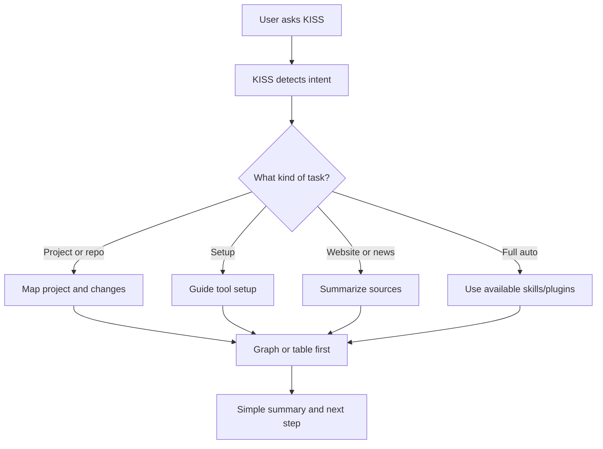

# KISS

KISS means **Keep It Simple, Stupid**.

KISS is a planned Codex plugin that helps users understand projects, coding runs, setup steps, websites, news, and tool updates in a simple visual format.

The main idea is simple:

> If something can be done safely without user interaction, KISS should do it.
> If information is easier to understand as a graph or table, KISS should show that first.

## What KISS Does

| Version | Focus | Example |
| --- | --- | --- |
| v1 | Project understanding | `/kiss what changed` |
| v1.5 | Setup, website, and news summaries | `/kiss setup <project_name>` |
| v2 | Full-auto fix and updates | `/kiss full auto update` |

## How It Works

## Planned Commands

| Command | Purpose |
| --- | --- |
| `/kiss what changed` | Summarize git changes after a coding run |
| `/kiss what does this project do` | Explain a repo in simple language |
| `/kiss graph this repo` | Show how project parts connect |
| `/kiss setup <project_name>` | Install or guide setup for a tool |
| `/kiss setup superpower` | Example setup request for Superpowers |
| `/kiss <long run log>` | Explain what happened in a long agent run |
| `/kiss update` | Show installed tools and available updates |
| `/kiss full auto fix my bug` | Use available skills to debug, plan, fix, and report |

## License

MIT
