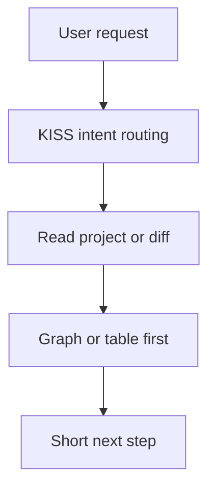

# Graph Reference

Use a Mermaid graph when relationships, flow, or dependencies are easier to understand visually.

## Use A Graph For

| Situation | Graph type |
| --- | --- |
| Project components | `flowchart TD` |
| Request/data flow | `sequenceDiagram` only when order matters |
| Before/after architecture | two small `flowchart TD` graphs |
| Tool or skill routing | `flowchart TD` |

## Rules

- Keep node labels short.
- Use quoted labels when labels contain spaces or punctuation.
- Do not include more than 12 nodes unless the user asks for detail.
- Add one sentence after the graph explaining the main takeaway.
- Use a table instead when the content is mostly comparison.

## Template

